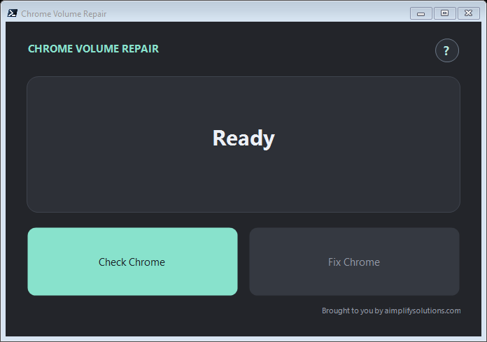

# Chrome Volume Fix

Brought to you by [aimplifysolutions.com](https://aimplifysolutions.com).

A small Windows app for one frustrating problem: **Chrome is barely audible even though Windows Volume Mixer says 100%.**

## Download

**[Download ChromeVolumeRepair.exe](https://github.com/aimplifysolutionsllc/ChromeVolumeFix/releases/latest/download/ChromeVolumeRepair.exe)**

Windows 10/11. Portable: no installation, Chrome extension, administrator access, or separate .NET runtime download needed on a standard Windows installation.

[All releases, ZIP downloads, and checksums](https://github.com/aimplifysolutionsllc/ChromeVolumeFix/releases/latest)



## How to use it

1. Open the downloaded `.exe` and choose **Check Chrome**.
2. If it says to play a video, play something in Chrome briefly, pause it, and check again.
3. If low levels are found, choose **Fix Chrome**. Pause Chrome audio and return any volume boosters to **100%** before confirming.
4. **Fixed** means the changed channels were read back and verified at 100%. Resume playback and set your ordinary speaker volume comfortably.

**No fix needed** means the channel levels checked by this app are already normal. The actual percentages appear beneath the result. Hover over **?** for a short explanation; keyboard users can focus it or press F1. Escape closes the help bubble.

## Why can Chrome be quiet at 100%?

Windows has an app's main volume and separate audio-session channel levels. The standard mixer shows the main volume, but not these separate channel settings.

On the original affected machine, Chrome's main volume was 100% while both hidden stereo channels were **1.584893%**. Restoring those channel values to `1.0` (100%) restored normal sound. A volume booster could not adequately compensate.

The app uses the documented Windows Core Audio interfaces `IAudioSessionManager2`, `IAudioSessionControl2`, and `IChannelAudioVolume`. It finds `chrome.exe` audio sessions, checks their channels, restores low channels only after confirmation, and verifies the result.

[Microsoft: IChannelAudioVolume](https://learn.microsoft.com/en-us/windows/win32/api/audioclient/nn-audioclient-ichannelaudiovolume)

## What it changes

- Only the Windows channel levels for the detected Chrome audio sessions.
- A session can include multiple Chrome tabs, so the change is not limited to the current tab.
- It leaves the normal speaker volume, app master volume, mute state, other applications, browser profile, and extensions alone.

Everything runs locally. There is no recording, telemetry, network connection, service, startup item, or background monitoring.

## Limits and download trust

This is a targeted repair, **not a universal audio fix or a volume booster**. It will not fix muted videos, a low player or mixer slider, the wrong output device, broken speakers, or every driver problem. Matching symptoms do not prove the same cause.

The app does not establish what lowered a channel level or prevent another application from changing it again. Windows normally persists session channel settings, but a full reboot was not part of the original validation.

The executable is **unsigned**. Windows may display a reputation warning for a downloaded copy. This repository includes the complete source and build instructions so it can be inspected or rebuilt. Published binaries are built by the repository's GitHub Actions workflow; each release includes SHA-256 checksums. No code-signing or SmartScreen reputation is claimed.

## Build and test from source

On Windows with the .NET Framework compiler available:

```powershell
.\Source\Build.ps1
.\Tests\RunTests.ps1
```

The build creates `ChromeVolumeRepair.exe` in the repository root. The app targets the Windows .NET Framework runtime, not the separate .NET 9 companion used by the optional browser-extension prototype.

Tests cover the confirmation gate, targeted repair and verified readback, preservation of other apps, normal/missing-session states, and refusing stale readings. Automated repair tests use simulated sessions to avoid changing the machine's audio. The actual Core Audio repair and independent readback were also verified on the original affected Chrome session; the UI was checked against a real Windows 11/Chrome installation.

## Report a problem

[Open an issue](https://github.com/aimplifysolutionsllc/ChromeVolumeFix/issues) with your Windows version, Chrome version, the result text, and the displayed channel percentages. Do not include credentials or private browsing information.

## License

[MIT](LICENSE)


